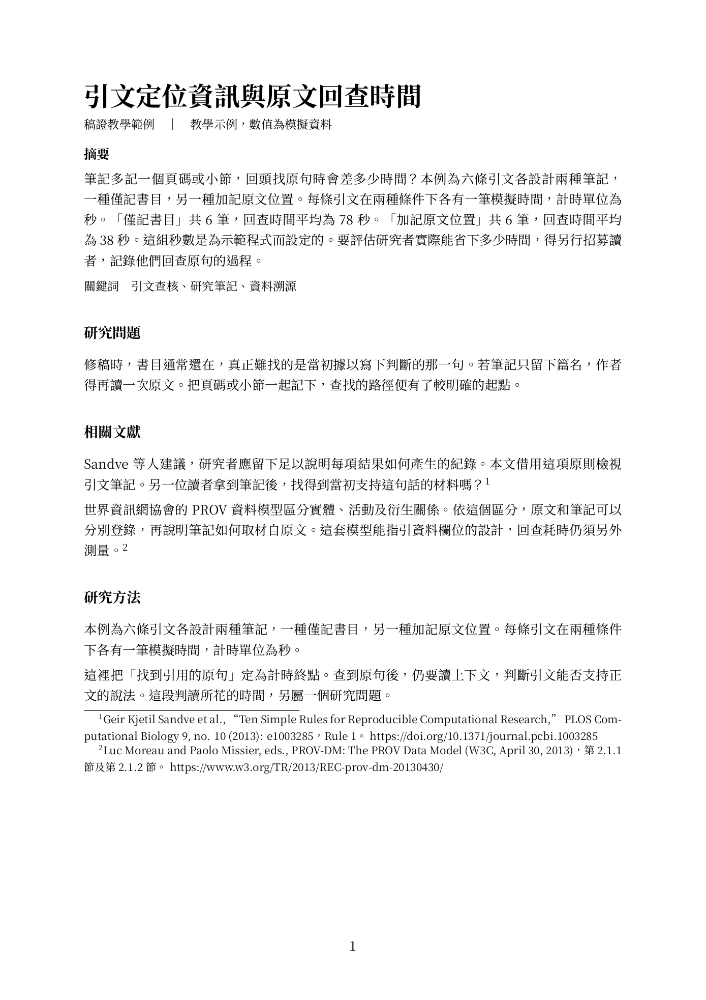
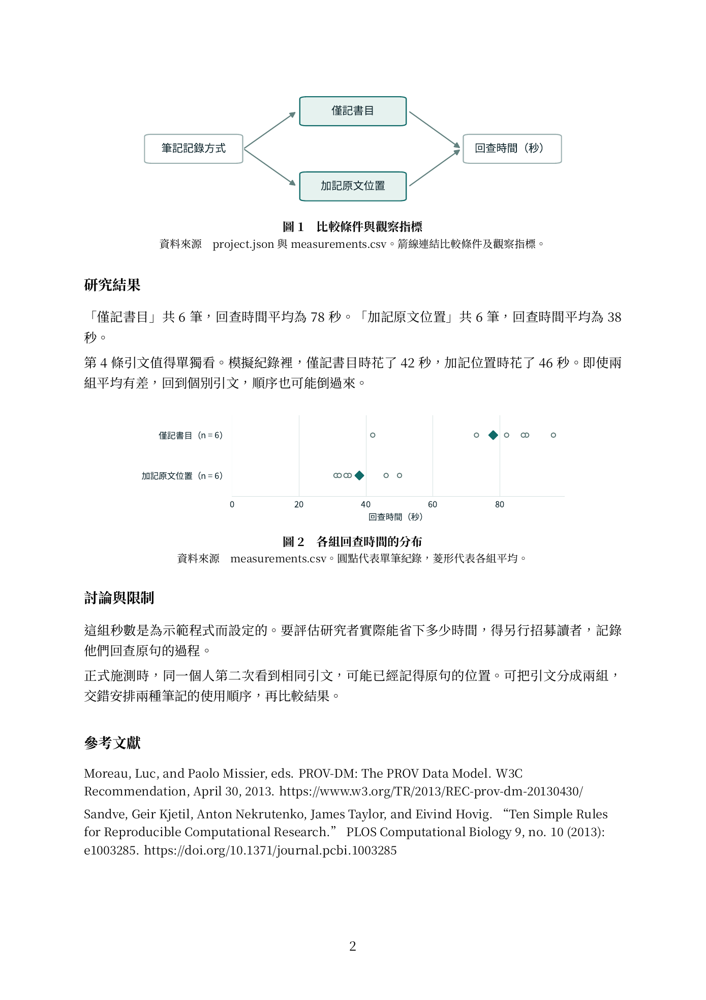

# 引文定位資訊與原文回查時間

這是稿證的兩頁論文範例。文中的回查時間採用教學用模擬資料。想在手機上放大文字，可以開啟全文閱讀。

[手機閱讀全文](draft.md) · [下載 PDF 原檔](draft.pdf?raw=true) · [下載 Word 檔](draft.docx?raw=true)

## 第 1 頁

## 第 2 頁

<!-- 更新範例 PDF 後，在專案根目錄執行 pdftoppm -r 168 -png preview/draft.pdf preview/pages/page。 -->
