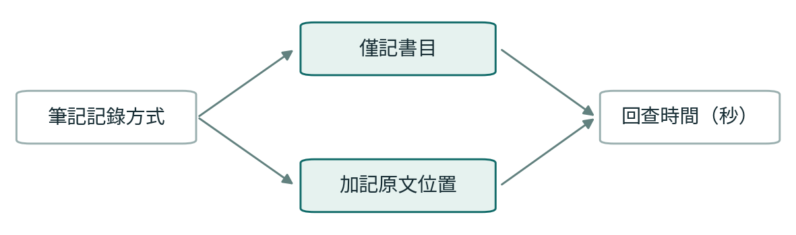
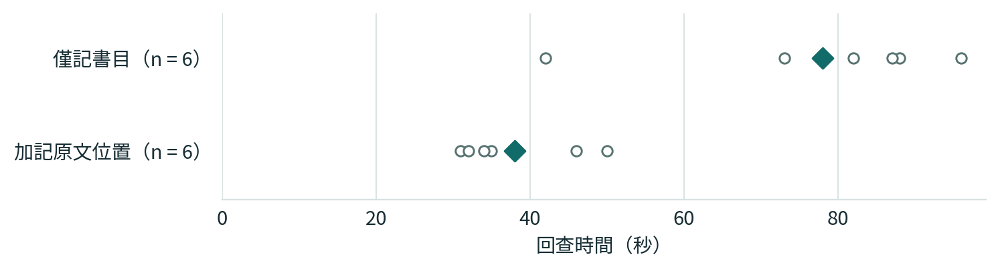

# 引文定位資訊與原文回查時間

稿證教學範例

**教學示例，數值為模擬資料**

## 摘要

筆記多記一個頁碼或小節，回頭找原句時會差多少時間？本例為六條引文各設計兩種筆記，一種僅記書目，另一種加記原文位置。每條引文在兩種條件下各有一筆模擬時間，計時單位為秒。「僅記書目」共 6 筆，回查時間平均為 78 秒。「加記原文位置」共 6 筆，回查時間平均為 38 秒。這組秒數是為示範程式而設定的。要評估研究者實際能省下多少時間，得另行招募讀者，記錄他們回查原句的過程。

關鍵詞　引文查核、研究筆記、資料溯源

## 研究問題

修稿時，書目通常還在，真正難找的是當初據以寫下判斷的那一句。若筆記只留下篇名，作者得再讀一次原文。把頁碼或小節一起記下，查找的路徑便有了較明確的起點。

## 相關文獻

Sandve 等人建議，研究者應留下足以說明每項結果如何產生的紀錄。本文借用這項原則檢視引文筆記。另一位讀者拿到筆記後，找得到當初支持這句話的材料嗎？[^R-sandve2013]

世界資訊網協會的 PROV 資料模型區分實體、活動及衍生關係。依這個區分，原文和筆記可以分別登錄，再說明筆記如何取材自原文。這套模型能指引資料欄位的設計，回查耗時仍須另外測量。[^R-prov2013]

## 研究方法

本例為六條引文各設計兩種筆記，一種僅記書目，另一種加記原文位置。每條引文在兩種條件下各有一筆模擬時間，計時單位為秒。

這裡把「找到引用的原句」定為計時終點。查到原句後，仍要讀上下文，判斷引文能否支持正文的說法。這段判讀所花的時間，另屬一個研究問題。

圖 1　比較條件與觀察指標

資料來源　project.json 與 measurements.csv。箭線連結比較條件及觀察指標。

## 研究結果

「僅記書目」共 6 筆，回查時間平均為 78 秒。「加記原文位置」共 6 筆，回查時間平均為 38 秒。

第 4 條引文值得單獨看。模擬紀錄裡，僅記書目時花了 42 秒，加記位置時花了 46 秒。即使兩組平均有差，回到個別引文，順序也可能倒過來。

圖 2　各組回查時間的分布

資料來源　measurements.csv。圓點代表單筆紀錄，菱形代表各組平均。

## 討論與限制

這組秒數是為示範程式而設定的。要評估研究者實際能省下多少時間，得另行招募讀者，記錄他們回查原句的過程。

正式施測時，同一個人第二次看到相同引文，可能已經記得原句的位置。可把引文分成兩組，交錯安排兩種筆記的使用順序，再比較結果。

## 參考文獻

Moreau, Luc, and Paolo Missier, eds. PROV-DM: The PROV Data Model. W3C Recommendation, April 30, 2013. <https://www.w3.org/TR/2013/REC-prov-dm-20130430/>

Sandve, Geir Kjetil, Anton Nekrutenko, James Taylor, and Eivind Hovig. “Ten Simple Rules for Reproducible Computational Research.” PLOS Computational Biology 9, no. 10 (2013): e1003285. <https://doi.org/10.1371/journal.pcbi.1003285>

[^R-prov2013]: Luc Moreau and Paolo Missier, eds., PROV-DM: The PROV Data Model (W3C, April 30, 2013)，第 2.1.1 節及第 2.1.2 節。 <https://www.w3.org/TR/2013/REC-prov-dm-20130430/>

[^R-sandve2013]: Geir Kjetil Sandve et al., “Ten Simple Rules for Reproducible Computational Research,” PLOS Computational Biology 9, no. 10 (2013): e1003285，Rule 1。 <https://doi.org/10.1371/journal.pcbi.1003285>
